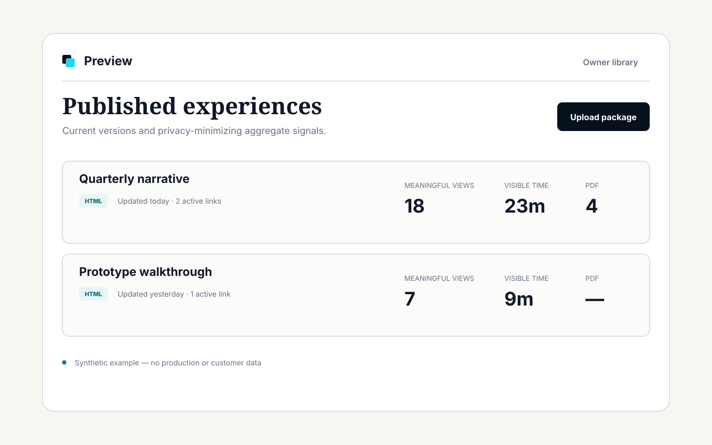
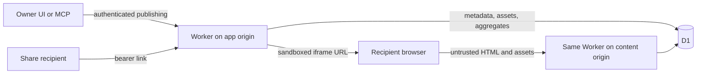

# Preview

I built Preview to share interactive HTML reports and other deliverables without deploying a separate website for each one. It lets me publish content, create links that expire or can be revoked, attach optional PDF companions, and see limited aggregate engagement.

I can manage publications and links through a web interface or an authenticated MCP server, including from AI clients and agents. The application runs on Cloudflare Workers and D1, with uploaded content isolated from the owner interface.

Preview is a personal tool I use in production. The source code is public for people interested in how it works or in running their own instance, not a hosted product for third parties.

[See Preview in action](https://preview.carlocaprini.com/) · [Self-hosting guide](docs/self-hosting.md) · [Fork this repository](https://github.com/carlocaprini/preview/fork)

> **Status:** In personal production use with publicly available source code. This is a reference implementation and case study, not a supported SaaS product. There is no support SLA, compatibility promise, or public roadmap.



_Synthetic interface example. It contains no customer or production data._

## What it does

- Publishes isolated, interactive HTML packages without redeploying the Worker.
- Creates stable bearer links that can expire or be revoked.
- Keeps only the latest HTML version durably, with a bounded grace period for
  already-open viewers.
- Optionally attaches a PDF companion to the current HTML version.
- Manages HTML publications, share links, aggregate analytics and optional PDF companions in the owner interface or through an authenticated MCP server for AI clients and agents.
- Counts meaningful displayed views, bounded visible time, and completed PDF
  deliveries as daily aggregates—never as identified or unique readers.

## Architecture at a glance



One Worker serves two explicit origins. The application origin owns the public
shell, owner UI, API, MCP endpoint, and authentication. The content origin
serves uploaded HTML and local assets from D1 inside a sandboxed iframe. The
Worker rejects unknown hosts; `workers.dev` and preview URLs are disabled in
the production configuration.

Owner sessions use a signed, host-only cookie and exact-origin mutation checks.
MCP uses an independent Bearer token. Public share URLs are bearer capabilities:
anyone who has a valid URL can use it until it expires or is revoked.

## Deliberate boundaries

Preview is not:

- a SaaS or multi-user document platform;
- a turnkey installer or one-click Cloudflare template;
- a public directory of shared content;
- a reader-identification, forwarding-detection, or profiling system;
- a supported product with an SLA or guaranteed roadmap.

The optional PDF companion is capped at 10 MiB. Automated tests cover its
lifecycle and streaming behavior with the repository's SQLite D1 adapter, but
the near-cap path has not completed an isolated remote Cloudflare probe. Free
tier eligibility also depends on current account-wide Cloudflare limits and is
not guaranteed.

## Documentation

- [Architecture and security boundaries](docs/architecture.md)
- [Operations, deployment, backup, and limits](docs/operations.md)
- [MCP publishing and transfer lifecycle](docs/mcp.md)
- [Minimal Cloudflare self-hosting guide](docs/self-hosting.md)
- [Historical product discovery](docs/product-definition.md)
- [Third-party notices](THIRD_PARTY_NOTICES.md)

The detailed security, contribution, support, and privacy guides
are tracked as separate public-release packages so each can be reviewed against
the behavior it describes.

## Local development and verification

Requirements: Node.js 22.18 or newer and npm.

```sh
npm ci
npm run check
npm run test:e2e
npx cf deploy --dry-run
```

Use `npm run dev` for local Worker development. The pinned Cloudflare `cf` CLI
is beta, so its commands and generated build output may change before a stable
release.

Pull requests run type checks, unit and integration tests, a production build,
dependency audit, and responsive Chromium acceptance tests without production
credentials or deployment. A push to `main` is the only repository event that
can run the production deployment workflow; it repeats the gates, applies D1
migrations, deploys, and probes production security boundaries.

## Project approach

Preview was developed specification-first with AI-assisted implementation and
review. Product decisions, deployment authority, and final ownership remain
human responsibilities.

## License and independent forks

Repository-owned code and documentation are available under the [MIT
License](LICENSE). Third-party components retain their own terms; copied
browser-delivered code is documented in [Third-party
notices](THIRD_PARTY_NOTICES.md).

Independent forks must replace Carlo Caprini's name, domains, credentials,
production identifiers, and personal-site attribution. A fork must not imply
affiliation with or endorsement by Carlo Caprini.

## Contributing and support

Read the [contribution guide](CONTRIBUTING.md) and [support policy](SUPPORT.md)
before opening an issue or pull request. Issues and contributions are considered
on a best-effort basis without an SLA, compatibility guarantee, or public
roadmap. Report vulnerabilities only through the private process described in
the [security policy](SECURITY.md).
